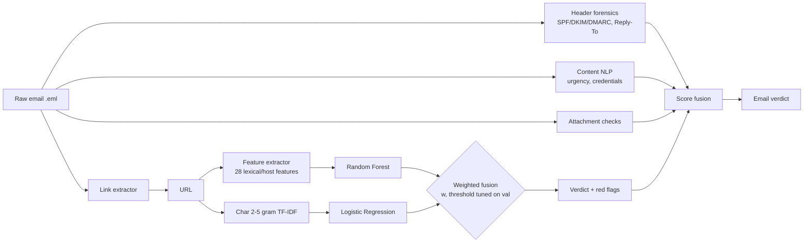
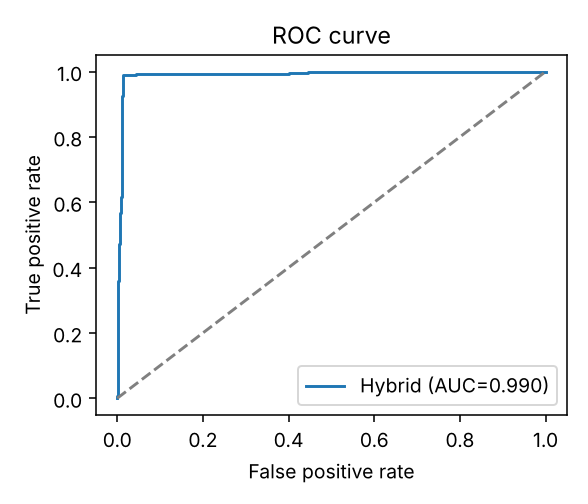
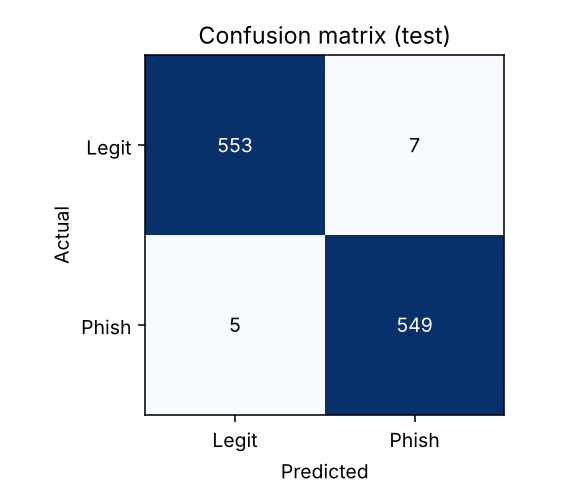

# 🛡️ PhishGuard — Hybrid ML Phishing Detection for URLs & Emails

PhishGuard detects phishing in **URLs** and **raw emails** using a hybrid machine-learning model
plus explainable forensic rules. It ships with a REST API, a web dashboard, a CLI, tests and Docker.


> Final-year cybersecurity project · Python · scikit-learn · FastAPI

## Features

| Area | What it does |
|---|---|
| **URL model** | 28 engineered lexical/host features → Random Forest, fused with a character 2–5-gram TF-IDF → Logistic Regression model. Fusion weight and threshold are tuned on a validation split. |
| **Typosquat detection** | Levenshtein distance + homoglyph substitution (`0→o`, `1→l`, …) against 25 high-value brands (PayPal, HDFC, SBI, Paytm, Microsoft…). |
| **Email forensics** | SPF/DKIM/DMARC results, From vs Reply-To vs Return-Path mismatch, display-name spoofing. |
| **Sender impersonation** | Lookalike sender domains (`service@paypa1.com`, `paypal-security.com`) and brand display names sent from unrelated domains (`"HDFC Bank" <noreply@secure-update.top>`), with an allow-list so genuine senders like Office 365 via outlook.com aren't flagged. |
| **Email content** | Urgency, credential requests, reward bait, generic greetings, embedded HTML forms. |
| **Deceptive links** | Anchor text shows `paypal.com` but `href` points elsewhere. Every link is scored by the URL model. |
| **Attachments** | Risky types (`.html`, `.iso`, `.lnk`, macro docs) and double extensions (`invoice.pdf.html`). |
| **Explainability** | Every verdict comes with human-readable red flags and per-branch probabilities. |
| **Defanged IOCs** | Paste indicators straight from threat-intel feeds — `hxxps://paypa1[.]com`, `evil(.)xyz`, `[:]//` are refanged automatically. `--defang` prints results in safe, non-clickable form. |
| **Interfaces** | Web UI, REST API (OpenAPI docs at `/docs`), CLI (single / batch / email). |

## Architecture



See [docs/ARCHITECTURE.md](docs/ARCHITECTURE.md) for the design rationale and
[docs/REPORT.md](docs/REPORT.md) for the project-report template (abstract, methodology, results).

## Quick start

```bash
git clone https://github.com/TrishaChetan/PhishGuard.git && cd PhishGuard
python -m venv .venv && source .venv/bin/activate      # Windows: .venv\Scripts\activate
pip install -r requirements.txt

python -m phishguard.train                 # trains on built-in synthetic data (offline)
uvicorn phishguard.api:app --reload        # open http://127.0.0.1:8000
```

Docker:

```bash
docker build -t phishguard . && docker run -p 8000:8000 phishguard
```

### CLI

```bash
python -m phishguard.cli url "http://paypa1-secure.xyz/login"
python -m phishguard.cli email samples/phish.eml
python -m phishguard.cli batch urls.txt --csv results.csv
```

### API

| Method | Endpoint | Body |
|---|---|---|
| POST | `/api/url` | `{"url": "..."}` |
| POST | `/api/urls` | `{"urls": ["...", "..."]}` (≤500) |
| POST | `/api/email` | `{"raw": "<full raw email>"}` |
| POST | `/api/email/upload` | multipart `.eml` file |
| GET | `/api/model` | feature importances, threshold |

## Training on a real dataset (for your report)

The synthetic generator is there so everything runs offline and tests are deterministic. **Report numbers should come from a real public dataset:**

| Dataset | Command |
|---|---|
| [PhiUSIIL Phishing URL Dataset](https://archive.ics.uci.edu/dataset/967/phiusiil+phishing+url+dataset) (UCI, ~235k URLs, label 1 = legitimate) | `python -m phishguard.train --data PhiUSIIL_Phishing_URL_Dataset.csv --invert-labels` |
| [Kaggle Malicious URLs](https://www.kaggle.com/datasets/sid321axn/malicious-urls-dataset) (`malicious_phish.csv`, url + type) | `python -m phishguard.train --data malicious_phish.csv` |

Training writes `reports/metrics.md` (comparison table of 5 models), `confusion_matrix.png`, `roc_curve.png` and `feature_importance.png`.

### Results on synthetic data

| Model | Accuracy | Precision | Recall | F1 | ROC-AUC |
|---|---|---|---|---|---|
| Logistic Regression (features) | 0.989 | 0.987 | 0.991 | 0.989 | 0.989 |
| Gradient Boosting (features) | 0.989 | 0.987 | 0.991 | 0.989 | 0.988 |
| Random Forest (features) | 0.989 | 0.987 | 0.991 | 0.989 | 0.990 |
| Logistic Regression (char n-grams) | 0.989 | 0.987 | 0.991 | 0.989 | 0.989 |
| **Hybrid fusion (PhishGuard)** | **0.989** | **0.987** | **0.991** | **0.989** | **0.990** |

All models reach the ~1.5% label-noise ceiling deliberately injected into the synthetic set, so these numbers only prove the pipeline works.
Differences between models show up on real data — re-run training on PhiUSIIL and paste the new `reports/metrics.md` here.

 

## Tests

```bash
pytest -q        # 13 tests: features, typosquatting, email forensics, API end-to-end
```

## Project structure

```
phishguard/
  url_features.py    28 lexical/host features + explanations
  email_analyzer.py  header forensics, content NLP, link & attachment checks
  model.py           hybrid RF + char-n-gram model, fusion tuning
  dataset.py         real-dataset loader + realistic synthetic generator
  train.py           training, model comparison, plots
  api.py             FastAPI service      templates/index.html  web UI
  cli.py             command-line tool
samples/             phishing + legitimate .eml examples
tests/               pytest suite
docs/                architecture + report template
```

## Limitations & future work

- Lexical-only URL model: no WHOIS age, DNS or page-content (HTML/screenshot) features — adding domain age and a visual-similarity model would catch compromised legitimate sites better.
- Content analysis is keyword-based; a fine-tuned transformer (e.g. DistilBERT on the Nazario / Enron corpora) would improve email text classification.
- A browser extension front-end could call `/api/url` in real time.

## License

MIT
